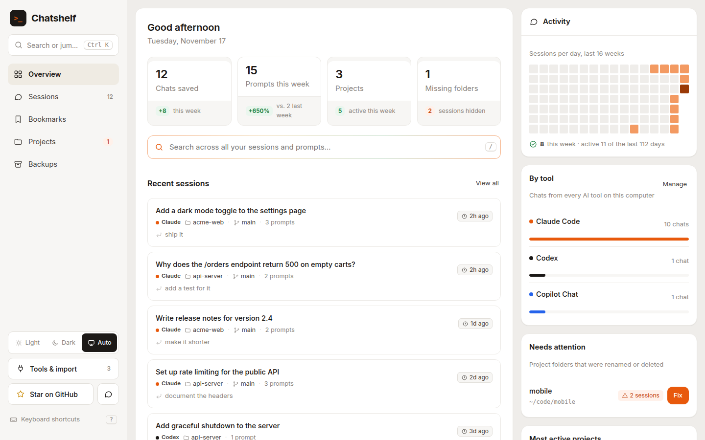
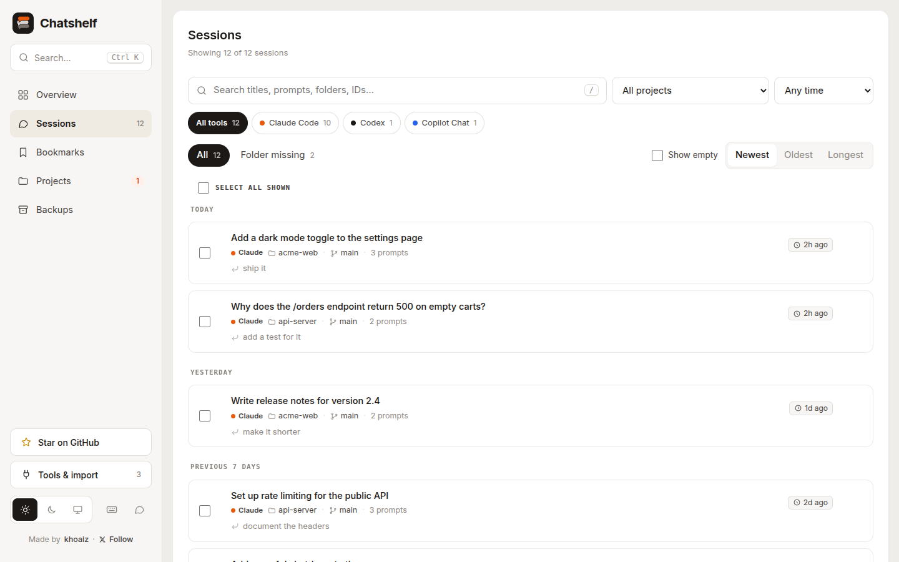
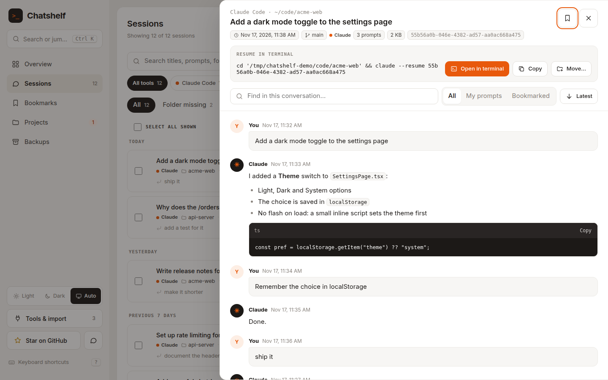
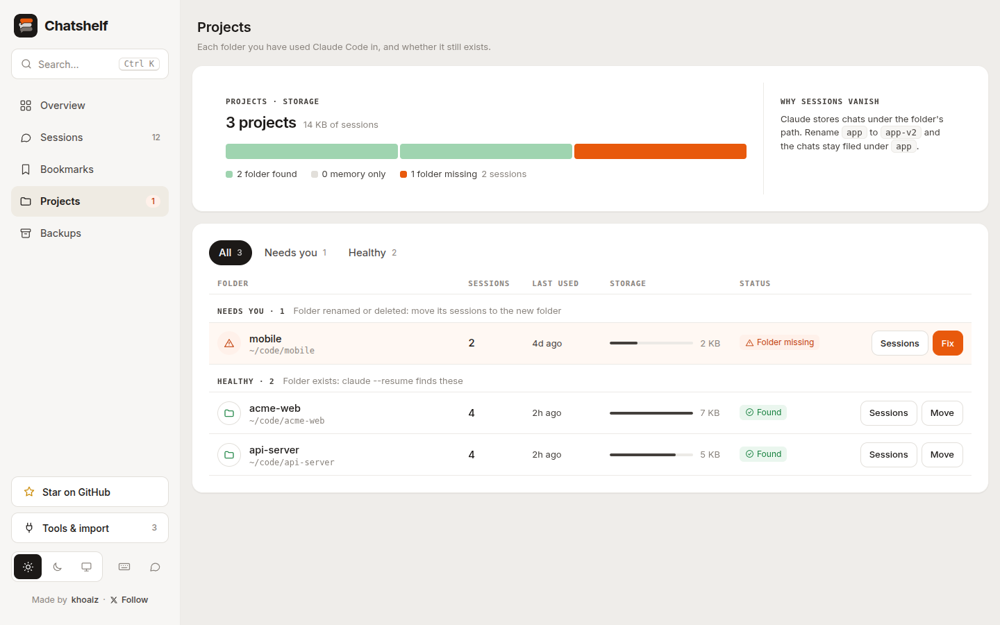
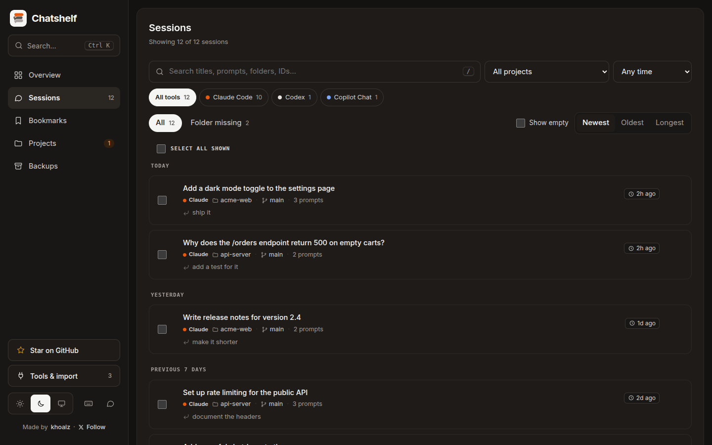

<div align="center">

# Chatshelf

**One place for your AI coding chats.**
Browse, search and bookmark your history from Claude Code, Codex, Cursor and GitHub Copilot, and get Claude Code sessions back after you rename a project folder.

[](https://github.com/heyKhoaiz/chatshelf/stargazers)
[](https://github.com/heyKhoaiz/chatshelf/actions/workflows/ci.yml)
[](LICENSE)




</div>

## Why

AI coding tools each keep their chat history in a different place, in a different format. Finding "that chat where we fixed the rate limiter" means remembering which tool, which folder and which day.

Claude Code has one more trap. It files every session under the folder's path, so **renaming a project folder makes its sessions disappear** from `claude --resume`. They're still on disk, under the old name.

Chatshelf reads all of it locally and puts it on one shelf.

## Features

- **Every tool in one list.** Claude Code, Codex, Cursor and GitHub Copilot Chat are read straight from your disk. ChatGPT and claude.ai come in through their data exports. OpenCode and Gemini CLI are experimental.
- **Search everything.** Titles, every prompt you typed, folders, branches and session IDs. Filter by tool, project and date (today, last 7 days, custom range…).
- **Read any chat.** Formatted Markdown, code blocks with copy buttons, the tools that ran, find-in-chat, and a "my prompts only" view.
- **Pick up where you left off.** One click resumes a Claude Code or Codex session in a terminal, or opens the project in Cursor or VS Code.
- **Fix renamed folders.** Chatshelf spots Claude Code projects whose folder no longer exists, suggests the new folder, and moves the sessions there, with a backup first.
- **Bookmarks.** Save whole chats or single messages, with notes. Bookmarks made with **Bookmark response** in the Claude Code VS Code extension show up too.
- **Made for the keyboard.** <kbd>Ctrl</kbd> <kbd>K</kbd> command palette, <kbd>j</kbd>/<kbd>k</kbd> to move, <kbd>/</kbd> to search, <kbd>?</kbd> for the full list.
- **Light and dark theme,** with reduced-motion support and 44px touch targets.
- **Private by design.** It runs on `127.0.0.1` only, has no dependencies and no telemetry, and never writes to other tools' files.

| Sessions | Conversation |
| --- | --- |
|  |  |
| **Projects: fix renamed folders** | **Dark theme** |
|  |  |

## Quick start

You need **Node.js 22.5 or newer**.

```bash
npx chatshelf        # opens http://127.0.0.1:4317
```

Or install it once and run `chatshelf` any time:

```bash
npm install -g chatshelf
chatshelf
```

From source (no dependencies, no build step):

```bash
git clone https://github.com/heyKhoaiz/chatshelf.git
cd chatshelf
npm start
```

To look around without your own history, run `npm run demo`. It uses fake chats in a temporary folder.

Options:

```bash
chatshelf --no-open             # don't open the browser
PORT=5000 chatshelf             # use another port
CHATSHELF_TERMINAL=kitty chatshelf   # pick the terminal for "Open in terminal"
```

## Supported tools

| Tool | Where it's read from (Linux) | Open / resume |
| --- | --- | --- |
| Claude Code | `~/.claude/projects/` | `claude --resume <id>` |
| Codex (CLI and IDE extension) | `~/.codex/sessions/` | `codex resume <id>` |
| Cursor | `~/.config/Cursor/User/globalStorage/state.vscdb` (opened read-only) | opens the project in Cursor |
| GitHub Copilot Chat | `~/.config/Code/User/workspaceStorage/*/chatSessions/` | opens the project in VS Code |
| OpenCode *(experimental)* | `~/.local/share/opencode/storage/` | `opencode` in the project |
| Gemini CLI *(experimental)* | `~/.gemini/tmp/*/chats/` | `gemini` in the project |
| ChatGPT, claude.ai | the export `.zip` you import in **Tools & import** | opens the chat on the website |

On macOS and Windows, Chatshelf looks in the matching application-data folders. The experimental readers follow each tool's documented storage layout and need testing with real data. [Help wanted!](CONTRIBUTING.md#add-or-fix-a-tool-reader)

## Fixing a renamed folder

1. Open **Projects**. Any folder that no longer exists is marked **Folder missing**.
2. Click **Fix**, then pick the new folder from the suggestions or browse to it.
3. Click **Move sessions**. Then `cd` into the new folder and run `claude --resume`.

A move:

- copies the affected files to `~/.claude/projects-backup/` first
- moves the sessions, their subagent files and the project memory, without overwriting anything
- updates the folder path stored inside each session, and keeps each file's original date

**Backups → Restore** puts a backup back.

## Where Chatshelf keeps its own data

| What | Where |
| --- | --- |
| Bookmarks | `~/.local/share/chatshelf/bookmarks.json` |
| Imported ChatGPT and claude.ai chats | `~/.local/share/chatshelf/imports/` |
| Search index cache | `~/.cache/chatshelf/` |

## Privacy and safety

- It listens on `127.0.0.1` only and rejects requests with an unexpected `Host` header, which blocks DNS rebinding.
- Every API call needs a random token that changes each time the server starts.
- It reads other tools' files but never changes them. The only writes outside its own folders are moving or restoring Claude Code sessions, and only when you click **Move** or **Restore**.
- One network request: the **Star on GitHub** button fetches the public star count from `api.github.com`, cached for 6 hours. Nothing about you or your chats is sent.

## Contributing

Contributions are very welcome, especially readers for more tools (Windsurf, Zed, Aider, Continue…) and testing the experimental ones. See **[CONTRIBUTING.md](CONTRIBUTING.md)**. It takes about five minutes to get going: no build step, no dependencies.

If Chatshelf helped you find a lost chat, **[give it a ⭐ on GitHub](https://github.com/heyKhoaiz/chatshelf)**. It helps other people find it.

## License

[MIT](LICENSE) © Shaikh khoaiz Ahmmed

Chatshelf is an independent project. It is not affiliated with Anthropic, OpenAI, Anysphere (Cursor), GitHub, Google or the other tools it reads. Product names belong to their owners.
