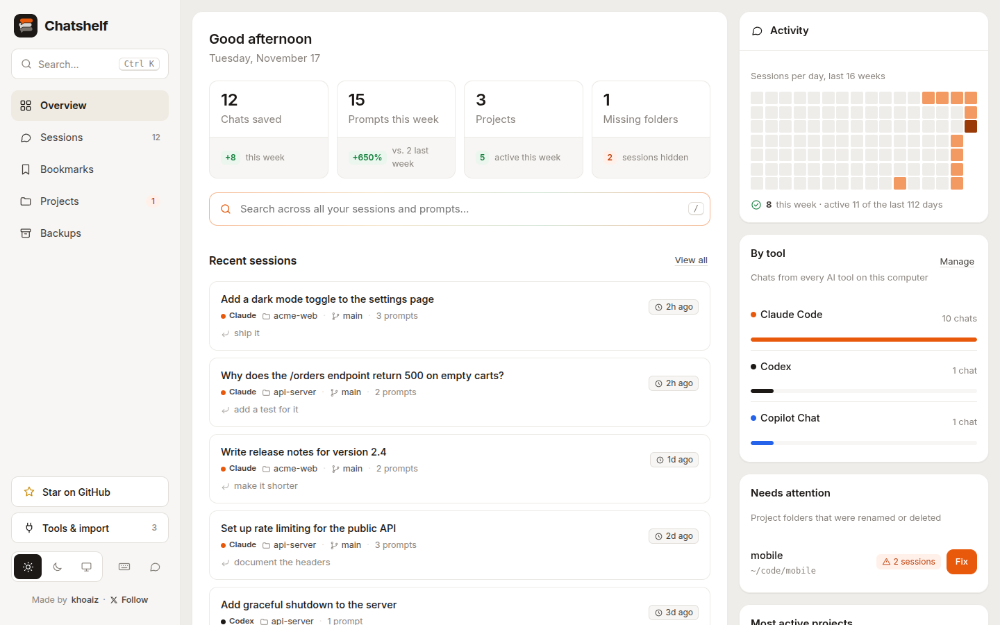

# Chatshelf for VS Code

One place for your AI coding chats, in an editor tab. Browse, search and bookmark your Claude Code, Codex, Cursor and Copilot Chat history. OpenCode and Gemini CLI are experimental. You can also import ChatGPT and claude.ai exports.

## Use it

Open the Command Palette and run **Chatshelf: Open**.

- **Resume a chat:** "Open in terminal" runs `claude --resume` (or `codex resume`) in VS Code's terminal, in the chat's project folder.
- **Fix a renamed folder:** if you renamed a project folder, its Claude Code sessions are listed under "Needs attention". Move them to the new folder. A backup is made first.
- **Hand off:** continue a chat in another tool, starting from a summary you can edit.

## Private by design

Chatshelf runs entirely inside VS Code. It starts no server, sends nothing over the network, and has no telemetry. It only reads other tools' files. The only files it changes are Claude Code sessions you choose to move or restore, and it backs them up first.

Over Remote SSH, WSL or Codespaces, it reads the chats on the remote machine.

## Also as a web app

The same app runs in your browser with `npx chatshelf`. See [the project on GitHub](https://github.com/heyKhoaiz/chatshelf).
